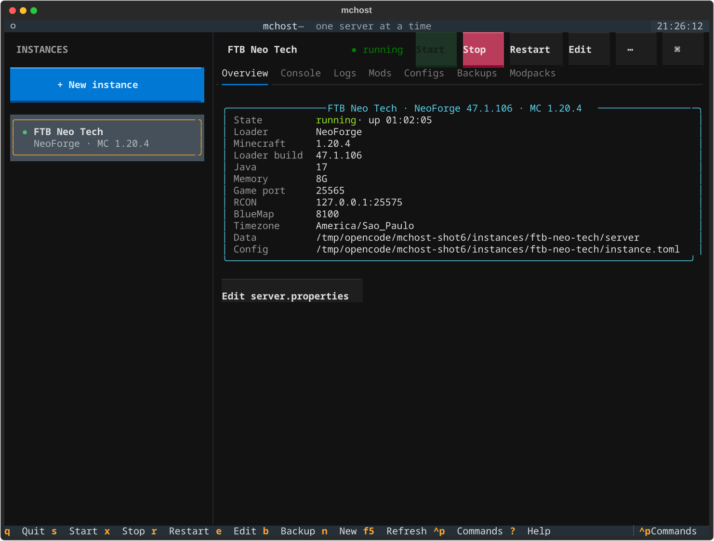
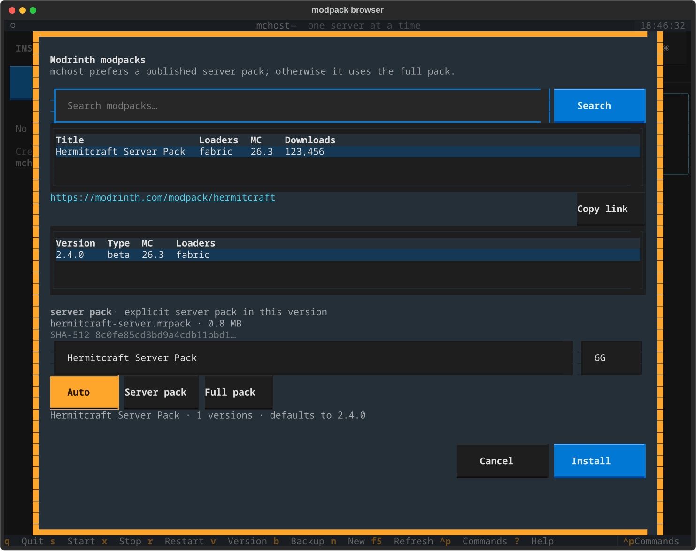
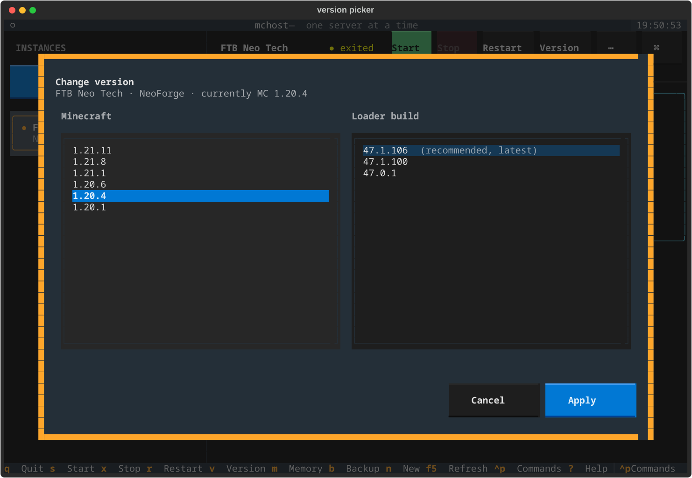
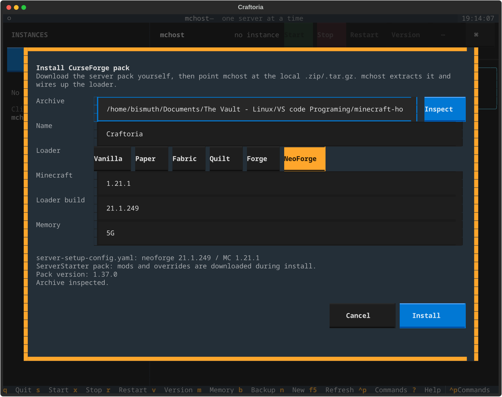

# mchost

A terminal app for hosting and managing containerized Minecraft servers. It
started as a single Docker Compose file for one server on a handheld PC; it is
now a host directory with a mouse-friendly dashboard, multiple instances, and
pinned Minecraft/loader versions.

Run `./mchost` (or `mchost tui`) to open the dashboard. Everything the
dashboard does is also available as a scriptable command.

---

## Features

- 🐳 Docker and Podman compatible
- 🎮 Vanilla, Paper, Fabric, Quilt, Forge, and NeoForge
- 📌 Pin the exact Minecraft version and loader build for every instance
- 🧭 In-app MC × loader picker with latest/recommended markers
- 📦 Multiple instances, one running at a time (stable ports, no surprises)
- 🖥️ Mouse-first terminal dashboard with sidebar, tabs, live logs, and RCON console
- ⏱️ Live uptime clock in the Overview while an instance is running
- ➕ Add-instance chooser: custom server, Modrinth pack, or local CurseForge pack
- 📂 Mods and Configs tabs: enable/disable/delete mods and edit configs in-app
- 💾 World and full backups with RCON-safe snapshots, retention, and restore
- 🧩 Modrinth modpack browser with server-pack preference and SHA-512 pinning
- ⬆️ Modpack update checks and in-place updates, with the pack's Modrinth link
- 📥 Install local CurseForge server packs you downloaded yourself
- 🗑️ Delete an instance, its data, and its backups with confirmation
- 🎚️ Change the Java heap post-creation, including for prebuilt modpacks
- ⌨️ Full keyboard shortcuts and a `Ctrl+P` command palette
- 🖱️ Right-click context menus and header action buttons
- 🧾 Scriptable CLI: create, start, stop, switch, logs, RCON commands
- 🔁 Import the original single-server `.env` without moving world data
- 🔐 RCON bound to `127.0.0.1` by default
- 🩺 `mchost doctor` for engine, port, memory, and ownership checks
- 🗺️ BlueMap port published out of the box
- 🔄 Syncthing-friendly: existing instance data paths are preserved
- 🌐 Works well with Tailscale for remote play

---

## Screenshots

| Dashboard | Modpack browser |
| --- | --- |
|  |  |

| Version picker | Local CurseForge pack |
| --- | --- |
|  |  |

_Demo data. The dashboard is fully operable with a mouse._

---

## Project structure

```text
minecraft-host/
├── src/mchost/
│   ├── config.py          # instance model + TOML
│   ├── engine.py          # Docker/Podman + compose
│   ├── compose.py         # generated compose files
│   ├── versions.py        # Mojang/Paper/Fabric/Quilt/Forge/NeoForge metadata
│   ├── modrinth.py        # Modrinth search, resolution, installs, updates
│   ├── localpack.py       # local CurseForge server-pack installer
│   ├── backups.py         # world/full backups, restore, retention
│   ├── files.py           # mod/config filesystem operations
│   ├── instances.py       # lifecycle helpers (delete)
│   ├── cli.py             # mchost commands
│   └── tui/               # Textual dashboard, modals, theme
├── tests/                 # 119 tests; mostly no Docker required
├── docs/screenshots/
├── instances/<slug>/      # per-instance config, compose, pack, data
├── backups/<slug>/        # per-instance backup archives
├── scripts/mc             # compatibility shim
├── mchost                 # uv bootstrap / entry point
├── pyproject.toml
├── uv.lock
└── README.md
```

`instances/`, `backups/`, and `.env` are gitignored. Only the placeholder
`.gitkeep` files are tracked. The legacy `.env` is imported once on first run
and is kept for the `scripts/mc` shim.

---

## Architecture

mchost is deliberately small and dependency-light:

- **Instance model:** `instance.toml` is the source of truth; `compose.yaml` is
  generated from it on every start or change. The `Instance` dataclass validates
  ports, memory, loader/version combinations, and data paths.
- **Engine wrapper:** `engine.py` shells out to Podman or Docker, auto-detects a
  working Compose provider, and keeps all lifecycle operations in one place.
- **Version resolution:** `versions.py` talks to Mojang, PaperMC Fill v3,
  Fabric, Quilt, NeoForge, and Forge metadata, with an on-disk TTL cache.
- **Modpacks:** `modrinth.py` searches Modrinth, resolves server/full artifacts,
  verifies SHA-512, parses `modrinth.index.json`, installs, and updates.
- **Local packs:** `localpack.py` inspects CurseForge server archives and infers
  the loader/MC from manifests, libraries, and launch scripts; it extracts and
  flattens the server files.
- **Backups:** `backups.py` uses RCON `save-off`/`save-all flush`/`save-on`,
  writes a manifest with checksums, and supports retention and safe restore.
- **TUI:** Textual screens and modals share the same core services as the CLI.
  Long operations run in worker threads so the dashboard stays responsive.
- **Compatibility:** the original single-server `.env` is migrated without
  moving world data, preserving Syncthing paths.

---

## Requirements

- Linux (tested on CachyOS and Bazzite)
- Docker with the Compose plugin, or Podman with `podman compose` / `podman-compose`
- [uv](https://docs.astral.sh/uv/) and Python 3.11+

---

## Quick start

From this directory:

```bash
./mchost                 # open the dashboard
./mchost doctor          # check the engine, ports, and existing instances
./mchost list            # first run imports the legacy .env automatically
./mchost new MyServer --loader fabric --mc-version 1.20.4 --loader-version 0.15.11 --memory 6G
./mchost start my-server
./mchost logs my-server
```

In the dashboard:

- Click an instance in the sidebar to open it. Instance cards are boxed;
  actions live in the header and the right-click menu.
- Click `+ New instance` (or press `n`) and choose **Custom server**,
  **Modrinth pack**, or **CurseForge pack**. Custom opens the version wizard;
  Modrinth opens the browser; CurseForge opens the local-archive installer.
- Use the header buttons for Start / Stop / Restart / Version.
- Right-click a row for Start, Stop, Restart, Change version, Backup, and Reveal data.
- Click tabs to switch between Overview, Console, Logs, Mods, Configs, Backups,
  and Modpacks.
- **Mods**: select a file to Enable/Disable (renames with `.disabled`) or Delete.
  The server must be stopped for changes.
- **Configs**: select a file and click Edit for an in-app text editor. Changes
  apply on the next restart.
- **Backups**: create world/full backups, restore, delete, and reveal.
- **Modpacks**: browse Modrinth, install a pack, check for updates, update in
  place, copy the pack's Modrinth link, or install a local CurseForge server
  pack you downloaded.
- The **Overview** shows status, loader/MC, ports, memory, and a live uptime
  clock while the server is running.
- **Memory**: right-click a row → **Change memory**, or press `m`. Works for
  hand-built servers and prebuilt modpacks; restart to apply.
- **Delete**: right-click an instance and choose **Delete instance**. The
  confirmation lists the instance, data, and backup paths; deleting stops the
  container and removes all three.
- Click `Ctrl+P` or the `⌘` button for the command palette.
- Keyboard: `s` start, `x` stop, `r` restart, `v` version, `m` memory,
  `b` backup, `n` new, `F5` refresh, `?` help, `q` quit.

List versions without opening the dashboard:

```bash
mchost versions neoforge --mc-version 1.20.4
mchost versions paper --mc-version 1.21.11
mchost versions fabric
```

`./mchost` is a small bootstrap that runs the project through `uv`. If you
prefer a command on your `PATH`:

```bash
uv tool install .
mchost list
```

---

## Instance layout

Each instance is a folder under `instances/`:

```
instances/my-server/
├── instance.toml      # source of truth (mode 600: it contains the RCON password)
├── compose.yaml       # generated by mchost; do not edit
├── server/            # `/data` inside the container
└── pack/              # modpack artifacts (when kind = "modpack")
```

`instance.toml` looks like this:

```toml
name = "My Server"
slug = "my-server"
kind = "server"
loader = "fabric"
mc_version = "1.20.4"
loader_version = "0.15.11"
memory = "6G"
tz = "America/Sao_Paulo"
java_version = 17
eula = true
rcon_password = "generated-per-instance"
port = 25565
rcon_port = 25575
bluemap_port = 8100
created_at = "2026-11-07T15:00:00+00:00"
```

`mchost` regenerates `compose.yaml` from this file on start and whenever
`mchost compose <name> --write` is run. The container is named `mc-<slug>` and
the Compose project is `mc-<slug>`.

### Version pinning

`--mc-version` and `--loader-version` are stored exactly as given and passed to
the container as `VERSION` and `NEOFORGE_VERSION`, `FORGE_VERSION`,
`FABRIC_LOADER_VERSION`, `QUILT_LOADER_VERSION`, or `PAPER_BUILD`. The Java
image tag is derived from the Minecraft version (`java8`, `java17`, `java21`,
`java25`) and can be overridden with `--java`.

When `--loader-version` is omitted, `mchost new` resolves the recommended build
from the loader's own metadata and writes that exact version. Existing
instances can be changed from the dashboard's `Version` button, which lists
Minecraft versions and every loader build with latest/recommended markers.
The same data is available from the shell with `mchost versions`.

### One server at a time

Starting a second instance is refused so that the game port, RCON port, and
BlueMap port stay stable:

```bash
mchost switch my-other-server
```

`switch` stops the running server (restoring file ownership first) and starts
the target.

### Memory

The Java heap is stored as `MEMORY` in the generated compose file. Change it
after creation from the dashboard (`m` or More → Change memory) or from the
shell:

```bash
mchost memory my-server 8G
```

This works for normal servers and for instances managed by a prebuilt modpack.
Restart the instance to apply the new heap.

---

## CLI reference

```text
mchost | mchost tui                 open the interactive dashboard
mchost list | ls                    list instances and their state
mchost status [name]                details for one instance
mchost new <name> [options]         create an instance
mchost versions <loader> [--mc-version X]  list Minecraft or loader versions
mchost start <name> [--switch]      start (optionally replacing the running one)
mchost stop <name>                  stop and restore file ownership
mchost restart <name>               stop, restore ownership, start
mchost switch <name>                stop whatever is running, start this one
mchost logs <name> [--tail N]       follow container logs
mchost console <name>               interactive RCON console
mchost cmd <name> "<command>"       send one RCON command
mchost path <name> [--json]         show config, data, and backup paths
mchost compose <name> [--write]     show or regenerate compose.yaml
mchost backup <name> [--kind world|full] [--keep N]
mchost backups <name> [--json]      list backups
mchost restore <name> <id|latest> [--start] [--yes]
mchost prune <name> [--keep N]      delete old backups
mchost delete-backup <name> <id> [--yes]
mchost modpack search <query> [--limit N] [--json]
mchost modpack versions <slug> [--json]
mchost modpack resolve <slug> [--version V] [--mode auto|server|full]
mchost modpack install <slug> [--version V] [--name NAME] [--mode ...]
mchost modpack check <instance>     check for a newer pack version
mchost modpack update <instance> [--version V] [--mode ...] [--no-restart]
mchost modpack local <path> [--name NAME] [--loader L] [--mc-version V]
mchost memory <name> <value>        change Java heap (e.g. 8G)
mchost delete <name> [--yes]        delete the instance, data, and backups
mchost import <dir> [options]       adopt an existing server directory
mchost migrate [--force]            import the legacy .env
mchost doctor                       health checks
```

Global option: `--root <dir>` selects the host directory. By default mchost
walks up from the current directory looking for `instances/`.

### `new` options

```text
--loader {vanilla,paper,fabric,quilt,forge,neoforge}
--mc-version VERSION
--loader-version BUILD
--memory 4G
--tz America/Sao_Paulo
--java 17
--port 25565
--rcon-port 25575
--bluemap-port 8100
--no-bluemap
--motd "..."
--rcon-password ...
--no-restore-ownership
--no-pin                            leave the loader build unpinned
```

If `--mc-version` is omitted on an interactive terminal, mchost prompts for it.
If `--loader-version` is omitted, mchost asks the loader metadata for the
recommended build and pins it. Pass `--no-pin` to keep the container's
"latest" behavior.

---

## Migrating the original setup

The old workflow used `INSTANCE`, `TYPE`, `VERSION`, `MEMORY`, `TZ`, and
`RCON_PASSWORD` in `.env` and a single root `compose.yaml`. On first run,
`mchost` imports that file automatically:

- The instance is written to `instances/<slug>/instance.toml`.
- **The data stays at `instances/<INSTANCE>/server`.** Renaming that folder
  would make Syncthing see a delete/create pair, so `instance.toml` records a
  `data_dir` pointing at the original path instead.
- Compose mounts that path relatively (`../FTBNeoTech/server:/data:Z`).
- `.env` is left untouched so `scripts/mc` keeps working.

Run `mchost migrate --force` to re-import it. The marker lives in
`.mchost/migrated.json`.

`scripts/mc` is now a thin compatibility shim. It reads `INSTANCE` from `.env`
and forwards to mchost:

```bash
./scripts/mc start
./scripts/mc logs
./scripts/mc cmd "say hello"
```

New scripts should call `mchost` directly.

---

## Health checks

`mchost doctor` verifies:

- Docker/Podman and a working Compose provider
- Host directory permissions
- Legacy `.env` migration state
- Invalid or unreadable instance configs
- Per-instance memory against host RAM
- Game, RCON, and BlueMap port availability
- Data-directory ownership after container shutdown
- RCON exposure (it should stay on localhost)

---

## Backups

Backups live in `backups/<slug>/<UTC timestamp>/` as `backup.tar.gz` plus a
`manifest.json` (size, SHA-256, included paths, and the instance config). Two
profiles are available:

- `world` (default): `world*`, `config/`, `defaultconfigs/`, and server
  metadata such as `server.properties`, whitelists, and ops.
- `full`: everything under the server directory except logs, crash reports,
  caches, `libraries/`, and `versions/`.

If the server is running, mchost sends `save-off` and `save-all flush` over
RCON, waits for the world to settle, creates the archive, and always sends
`save-on` afterwards. If the server cannot be quiesced, the backup fails rather
than producing an inconsistent archive; stop it and retry.

Retention defaults to the instance's `backup_keep` (5) and runs after each
backup. Restores stop the server, replace the selected paths, and optionally
start it again. From the dashboard, use the **Backups** tab; every action is a
button.

```bash
mchost backup my-server --kind world
mchost backups my-server
mchost restore my-server latest --yes --start
mchost prune my-server --keep 3
```

---

## Modrinth modpacks

The **Modpacks** tab opens a browser with search, version selection, and an
install button. It also prefers a **published server pack**:

1. A server-marked file in the selected version (`*-server.mrpack`,
   `*server-pack*.zip`, concatenated `serverpack`, etc.).
2. A server-only sibling version of the same release.
3. Otherwise the full `.mrpack`, which is already server-aware on Modrinth.

Every artifact is downloaded locally to `instances/<slug>/pack/`, verified
against Modrinth's SHA-512, and mounted read-only. `.mrpack` packs install via
`MODRINTH_MODPACK`; `.zip` server packs use `GENERIC_PACK`. The instance config
records the project, version, artifact, checksum, and resolved loader/MC so the
install is reproducible.

The browser shows the selected pack's Modrinth page as a clickable link (and a
**Copy link** button for terminals without hyperlink support). The **Modpacks**
tab shows the installed pack, its link, and a **Check for updates** action.
Updates re-resolve the server/full artifact, verify the new SHA-512, replace
the pack file, update the loader/MC fields, and restart the server if it was
running.

```bash
mchost modpack search cobblemon
mchost modpack resolve hermitcraft
mchost modpack install hermitcraft --name "Hermitcraft" --mode server
mchost modpack check hermitcraft
mchost modpack update hermitcraft --no-restart
```

### Mods and configs

The **Mods** tab lists files with an enabled/disabled state. Disabling renames
a mod to `*.disabled`; enabling removes the suffix. Deleting asks for
confirmation. All mod changes require the server to be stopped.

The **Configs** tab opens a text editor for UTF-8 files up to 512 KB. Saves are
atomic and preserve file permissions. Restart the server to apply changes.

### Local CurseForge packs

mchost does **not** download CurseForge packs. Download the **server pack**
yourself, then use **Modpacks → Install CurseForge pack** in the dashboard (or
`mchost modpack local <path>`). mchost:

- inspects the archive for `manifest.json`, Forge/NeoForge libraries, launch
  scripts, and vanilla server jars to infer the loader, Minecraft version, and
  exact loader build;
- understands **TeamAOF ServerStarter** packs (`server-setup-config.yaml`),
  including their `modpackUrl`, loader version, client-mod ignore list, and
  suggested RAM;
- for ServerStarter packs, downloads the referenced pack archive, extracts its
  `overrides/`, and downloads the server mods listed in the CurseForge manifest
  into `mods/` (client-only projects and ignored file patterns are skipped);
- extracts ordinary archives into `instances/<slug>/server/`, flattening a
  single top-level wrapper folder;
- keeps the original archive and any downloaded pack archive in
  `instances/<slug>/pack/`; and
- configures `TYPE`, `VERSION`, and the loader version so itzg installs the
  matching loader on first start.

```bash
mchost modpack local ~/Downloads/MyPack-Server.zip
mchost modpack local ~/Downloads/MyPack-Server.zip --name "My Pack" \
  --loader forge --mc-version 1.20.1 --loader-version 47.2.0
mchost modpack local ~/Downloads/Craftoria-Server-1.37.0.zip
```

A ServerStarter install can take a while: the pack’s referenced mods are
downloaded from the URLs in its manifest, with progress shown in the dashboard.
The first install of a large pack can be several hundred MB.

Local packs are marked `source = "local"` in `instance.toml`; the Modpacks tab
shows them as local and disables the Modrinth update/link actions. To update
one, install a newer server pack as a new instance (or delete and reinstall).

### Deleting an instance

Right-click an instance → **Delete instance**, or run:

```bash
mchost delete my-server
mchost delete my-server --yes
```

The container is stopped first, then mchost removes the instance directory
(config/compose/pack), the data directory (including legacy external data
paths), and the instance's backups. Deletion is irreversible.

---

## Development

```bash
uv sync
uv run pytest
./mchost --help
```

The suite covers config/compose generation, migration, version and Modrinth
resolution, backup archives and restores, local CurseForge pack inspection,
instance deletion, and Textual flows using a fake engine. Most tests do not
need Docker or network access.

For a guided reading order through the codebase, see
[LEARNING.md](LEARNING.md).

### Good to know

- RCON is published on `127.0.0.1` by default.
- `instance.toml` and generated `compose.yaml` are mode `600` because they
  contain the RCON password.
- Backups contain world/config data; store them somewhere you trust.
- mchost runs one server at a time so ports stay stable.
- The original `.env` is kept for the `scripts/mc` shim; mchost itself uses
  `instances/<slug>/instance.toml`.

---

## Status and roadmap

- **Phase 1 — foundation and CLI:** done.
- **Phase 2 — dashboard:** done. Sidebar, overview, live logs, RCON console,
  command palette, right-click menus, and mouse actions.
- **Phase 3 — versioning and new instances:** done. Live metadata providers for
  Mojang, PaperMC, Fabric, Quilt, NeoForge, and Forge; `mchost versions`; the
  in-app Minecraft × loader picker; the new-instance wizard; recommended/latest
  markers.
- **Phase 4 — operations:** done. Backups (world/full, RCON-safe, retention,
  restore), mod enable/disable/delete, in-app config editing, and instance
  deletion.
- **Phase 5 — modpacks:** done. Modrinth search, server-pack preference for
  `.mrpack`/`.zip`, SHA-512 pinning, local installs, update checks, in-place
  updates, Modrinth links, and user-provided CurseForge server packs.

Possible next steps: native async RCON, creating/renaming config files from the
UI, drag-free mod ordering/profiles, concurrent instances with per-instance
ports, and a read-only web status page.

---

## Why?

- Easy to recreate
- Easy to back up
- Easy to synchronize between machines
- Independent from any launcher
- Simple enough to remember six months later

Instead of shell commands scattered across Discord messages and browser
bookmarks, this repository is a self-contained hosting environment.

---

## Tested on

- ASUS ROG Ally
- Bazzite Linux
- CachyOS
- Docker with Compose v2
- NeoForge 1.20.4
- Vanilla 1.21.1
- Vanilla 26.3 with Java 25
- Fabric and Forge modpacks via Modrinth

---

## License

MIT
